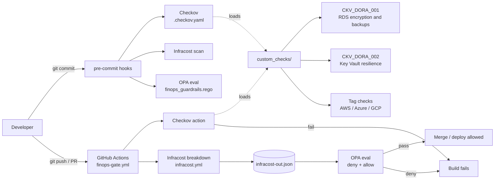
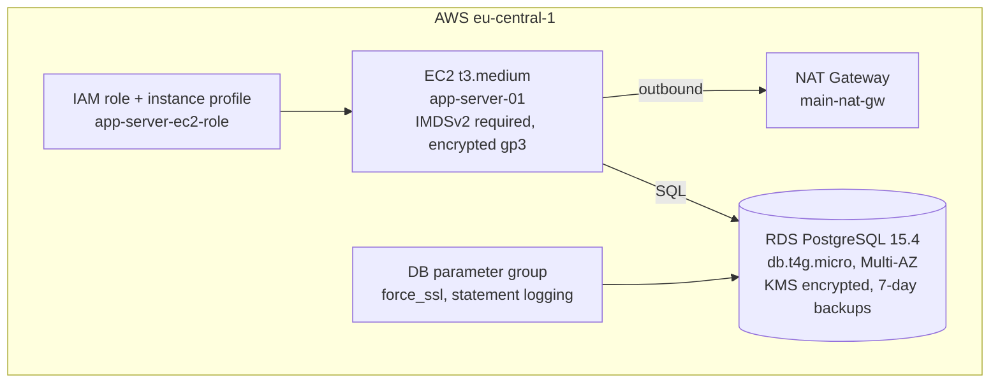
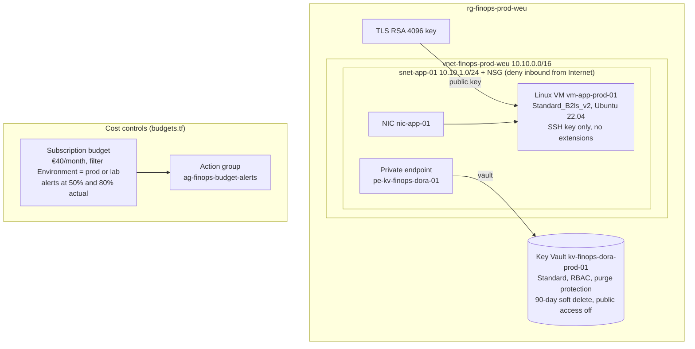
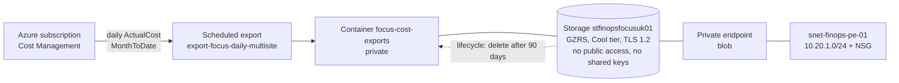

# Architecture Overview

This document describes the architecture of the **Multi-Cloud Shift-Left FinOps & DevSecOps Lab**. The project is a demonstration repository. It defines Terraform for AWS, Azure, and GCP, and checks that infrastructure against cost and security policy **before** it is deployed.

## 1. Goals

| Goal | How it is met |
|---|---|
| Know what infrastructure will cost before it is deployed | Infracost prices each Terraform project. |
| Stop cost overruns in CI | OPA/Rego rules deny resources above $80/month and projects above $150/month. |
| Enforce security and tagging standards | Checkov built-in checks plus custom checks (tags, DORA/NIS2 resilience). |
| Catch problems early | Pre-commit hooks run locally, and a GitHub Actions workflow runs on push and pull request. |
| Make costs attributable | Mandatory tags or labels (`Environment`, `Owner`, `CostCenter`, plus `SiteID` and `ServiceTier` in the Azure example). |

## 2. Repository Layout

```
infracost-lab/
├── .github/
│   └── pull_request_template.md  FinOps PR cost-gate & client sign-off template
├── docs/
│   ├── architecture.md           Shift-left FinOps & DevSecOps architecture overview
│   └── opportunity-register.md   Cloud optimisation tracking & realised savings log
├── aws/                      Root module: AWS production workload (eu-central-1)
│   ├── main.tf
│   └── infracost-usage.yml   Usage estimates (NAT gateway data processed)
├── azure/                    Root module: Azure production workload (West Europe)
│   ├── main.tf               Network, VM, Key Vault + private endpoint
│   └── budgets.tf            Action group and subscription budget (€40/month)
├── gcp/                      Root module: GCP production VM (europe-west3)
│   └── main.tf
├── examples/
│   └── azure-multisite-finops/   Reference: FOCUS cost-export storage (UK South)
│       ├── main.tf
│       └── README.md
├── policies/
│   └── finops_guardrails.rego    OPA cost guardrails (deny / allow)
├── custom_checks/            Checkov extensions (Python + YAML)
├── infracost.yml             Maps the three cloud directories to Infracost projects
├── .checkov.yaml             Checkov configuration
├── .pre-commit-config.yaml   Local gates
└── .github/workflows/
    └── finops-gate.yml       CI gate
```

Each cloud directory is a standalone Terraform root configuration. The repository does not use `module` blocks or a shared `modules/` directory.

## 3. Component Diagram



## 4. Enforcement Pipeline

The same three gates run in two places. The local hooks give fast feedback, and the CI workflow is the authoritative check.

| Gate | Pre-commit (`.pre-commit-config.yaml`) | CI (`finops-gate.yml`) |
|---|---|---|
| Security and tagging | `.venv/bin/checkov`, runs on `.tf` changes | `bridgecrewio/checkov-action@v12`, scans `.` |
| Cost estimate | `infracost scan .` | `infracost breakdown --config-file infracost.yml` |
| Policy | `opa eval` on `inspect --json` output | `opa eval` on the breakdown JSON |
| Permissions | Local | `contents: read`, `pull-requests: write` |
| Trigger | Commit of `.tf` files | Push to `main`, PRs to `main`, manual dispatch |

**Policy decision logic** (`policies/finops_guardrails.rego`):

- `deny` collects violations:
  - Rule 1A and 1B: any resource with a monthly cost above $80. Rule 1A reads the local Infracost v2 format, and Rule 1B reads the v0.10.x format used in CI.
  - Rule 2: any project with a monthly cost above $150.
- `allow` is true only when `deny` is empty.
- CI runs `opa eval --fail` on `allow`, so a non-empty `deny` set fails the build.

## 5. Infrastructure Components

### 5.1 AWS: `aws/` (production, `eu-central-1`)



Key properties:
- EC2 enforces IMDSv2 (`http_tokens = required`), uses an encrypted gp3 root volume, and has detailed monitoring enabled.
- RDS is Multi-AZ, storage-encrypted with a customer KMS key, has `deletion_protection`, IAM database authentication, Performance Insights, and CloudWatch log exports for `postgresql` and `upgrade`.
- The parameter group sets `rds.force_ssl = 1`.
- Cost driver: the NAT gateway is priced on 500 GB/month of processed data (`infracost-usage.yml`).

### 5.2 Azure: `azure/` (production, West Europe)



Key properties:
- The NSG denies inbound traffic from the Internet, and the subnet has no public IP.
- The VM uses SSH key authentication only. The key is generated by Terraform (`tls_private_key`), which means the private key is stored in Terraform state.
- Key Vault is reachable only through its private endpoint. Access uses Azure RBAC. Purge protection is enabled, and the default network action is `Deny` with `AzureServices` bypass. These settings satisfy `CKV_DORA_002`.
- The budget is a subscription-level control. It is a runtime alert, not a deployment block.

### 5.3 GCP: `gcp/` (production, `europe-west3`)

- One `google_compute_instance` (`gce-app-prod-01`, `e2-standard-2`, Debian 12) in `europe-west3-a`.
- Shielded VM with secure boot, vTPM, and integrity monitoring.
- OS Login enabled, and project-wide SSH keys blocked.
- Attached to the `default` network. The configuration does not define its own VPC or firewall rules.
- Labels use the lowercase keys `environment`, `owner`, and `cost_center`.

### 5.4 Reference: `examples/azure-multisite-finops/` (UK South)

A standalone reference for FinOps reporting, not connected to the Infracost project map or the CI configuration.



- Tags include `SiteID`, `ServiceTier`, and `CostCenter`, intended for per-site chargeback.
- Exports are intended for Power BI ingestion, according to its README.

### 5.5 Subscription budget and tagging

- The Azure budget relies on the `Environment` tag: resources without it fall outside the budget filter. The Checkov tag checks in `custom_checks/` are intended to enforce the same tags. (I did not read the YAML check bodies in full.)
- Tag and label keys differ between clouds: AWS and Azure use `Environment`, `Owner`, and `CostCenter`, while GCP uses lowercase `environment`, `owner`, and `cost_center`. The custom check files reflect these differences.

## 6. Security and Resilience Controls

| Control | Where | Mechanism |
|---|---|---|
| DORA Art. 9/12, NIS2: RDS encryption and backup retention ≥ 7 days | `custom_checks/dora_nis2_resilience.py` (`CKV_DORA_001`) | Custom Checkov check |
| DORA Art. 9/11, NIS2: Key Vault purge protection, soft delete ≥ 7 days, default deny | `custom_checks/dora_nis2_resilience.py` (`CKV_DORA_002`) | Custom Checkov check |
| Cost tag enforcement | `custom_checks/finops_tags*.yaml`, `finops_labels_gcp.yaml` | Custom Checkov YAML checks |
| Checkov skip list | `.checkov.yaml` skips `CKV_GCP_38`. Inline skips in the example for `CKV_AZURE_33`, `CKV2_AZURE_1`, and `CKV2_AZURE_21`, each with a justification. | Checkov configuration and inline annotations |
| Private networking | Azure Key Vault and the FOCUS storage account, both via private endpoints | Terraform |
| Identity and transport | IMDSv2 on AWS EC2, TLS 1.2 minimum on Azure storage, `force_ssl` on RDS | Terraform |

## 7. Cost Model

- **Infracost projects** (`infracost.yml`): `aws-prod-eu-central-1`, `azure-prod-westeurope`, `gcp-prod-europe-west3`.
- **Usage estimates**: only AWS has a usage file, which models 500 GB/month through the NAT gateway. Other resources use Infracost defaults.
- **Guardrails**:

| Level | Limit | Enforced by |
|---|---|---|
| Per resource | $80/month | OPA `deny` (rules 1A and 1B) |
| Per project | $150/month | OPA `deny` (rule 2) |
| Azure subscription | €40/month, with alerts at 50% and 80% | Azure Consumption Budget (runtime alert only) |

## 8. Known Limitations and Observations

These are things a reviewer should be aware of. The repository is a lab, so some are intentional.

1. **Placeholder identifiers.** The AWS AMI, NAT allocation and subnet IDs, and KMS ARNs (`123456789012`) are placeholders. `terraform plan` will not succeed against a real account without changes.
2. **Missing network definitions.** The AWS NAT gateway references an existing subnet and EIP by ID, and the GCP VM uses the `default` network. Neither has its network defined in this repository.
3. **Secrets in state.** The Azure VM SSH private key is created by `tls_private_key`, so it is stored in Terraform state. A remote, encrypted backend is needed for real use. No backend is configured in any root module.
4. **Provider version pins.** AWS uses `~> 5.0`, Azure uses `~> 3.100` (AzureRM 3.x), and GCP uses `~> 5.0`. Only the AWS and GCP constraints are for the same major version family.
5. **Example and README mismatch.** The Azure example README describes a hub-and-spoke network with VPN and ExpressRoute, but the code contains a single VNet and no gateways.
6. **Deletion behavior.** The AWS RDS instance sets `deletion_protection = true` but also `skip_final_snapshot = true`. A deletion would proceed without a final snapshot once protection is removed.
7. **Azure VM has no public IP and no inbound allow rule.** Admin access requires another path, such as a bastion or VPN, which is not defined here.
8. **Hard-coded values.** Regions, CIDR ranges, the budget date window, and the Azure alert email (`finops-alerts@example.com`) are hard-coded.
9. **Mixed languages.** The Rego rule messages and the custom check names and descriptions are in Polish. Other documentation and code comments are in English.

## 9. Extending the Architecture

- **New cloud resource:** add it to the relevant root directory, tag it with the required keys, and confirm that Checkov and the OPA rules still pass.
- **New project:** add an entry to `infracost.yml`, and add a usage file if the cost depends on consumption.
- **New policy:** add a rule to `policies/finops_guardrails.rego` and keep the `deny` and `allow` structure. Test both Infracost formats.
- **New check:** add a Python class under `custom_checks/` that extends `BaseResourceCheck`, or add a YAML check for simple attribute tests.
- **Shared code:** if the three clouds need common logic, move it into a `modules/` directory and reference it with `source`. This is not done today.
